# Galaxy Ring — Concept Site

An interactive, scroll-driven product page for the Samsung Galaxy Ring, built with Next.js, React Three Fiber and GSAP. The ring and its clear charging case are modeled from scratch in code with three.js: no downloaded 3D files.

> Fan-made concept. Not affiliated with or endorsed by Samsung.

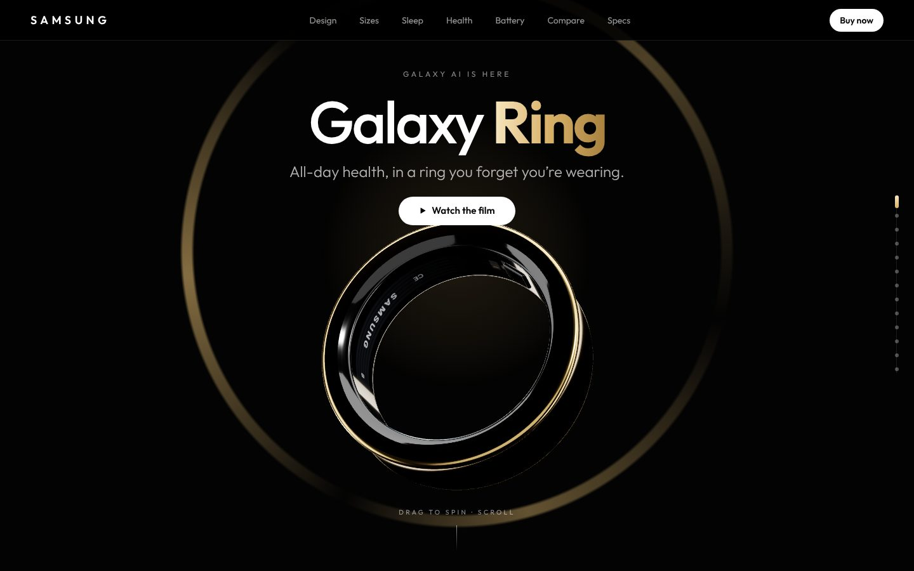

## Highlights

- **A ring built in code:** the concave titanium shell, the glossy inner lining with visible chips, LEDs and printed markings, the sensor bumps and the charging case (clear lid with a white plate and chrome rim, white charging puck) are all generated procedurally.
- **Scroll-driven 3D story:** the ring turns to show its concave profile, tilts to reveal the glowing sensors inside, then drops onto the charger while the lid closes.
- **Interactive hotspots** pinned to the titanium frame, the concave face, the optical sensors and the skin temperature sensor.
- **Find your size:** pick sizes 5 to 13 and see the inner diameter, weight and battery life change.
- **Sleep:** switch between example nights to see the hypnogram, Sleep Score, sleeping heart rate and skin temperature.
- **Energy Score:** sliders for sleep, activity and sleeping heart rate, with a live heart-rate trace.
- **Double pinch:** take a photo or stop an alarm on a phone mockup.
- **Battery:** rings for up to 7 and 6 days that fill as you scroll, plus case and charging facts.
- **Colors:** Titanium Black, Silver and Gold. The finish you pick sets the accent color of the whole page and is remembered for your next visit.
- **Ring or Watch?** A side-by-side with Galaxy Watch Ultra2.
- **Watch the film** auto-scroll tour and a **section menu** rail on the right.
- **Galaxy ecosystem:** links to the [Galaxy S26 Ultra](https://s26-ultra-concept.vercel.app), [Galaxy Buds4 Pro](https://buds4-pro-concept.vercel.app) and [Galaxy Watch Ultra2](https://watch-ultra2-concept.vercel.app) concept sites.

## Screenshots

| | |
|---|---|
| 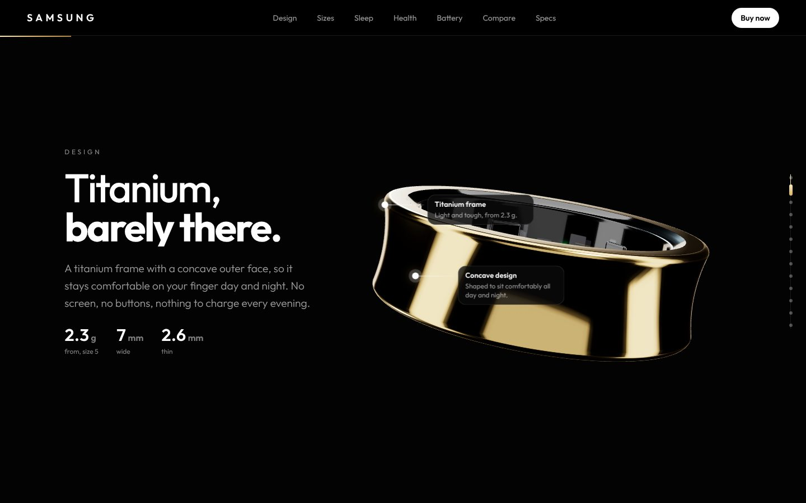 | 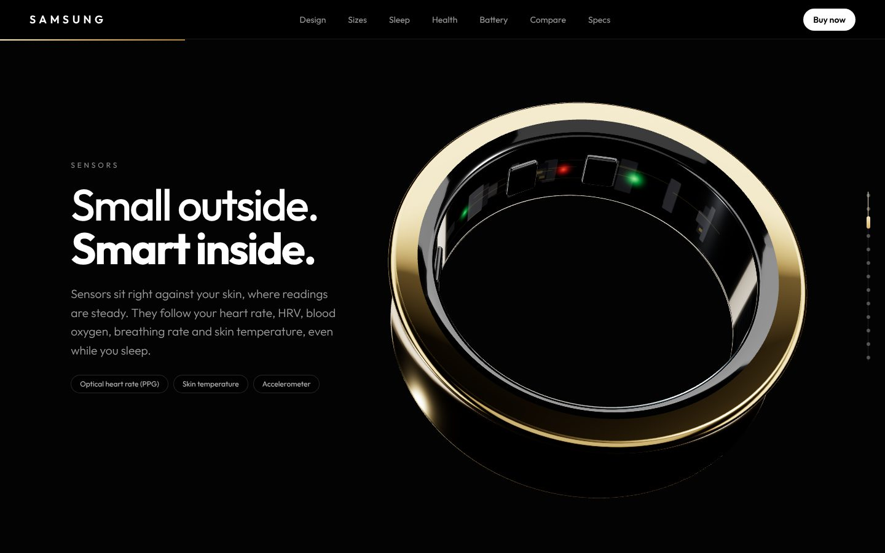 |
| **Titanium design** with hotspots | **Sensors** inside the ring |
| 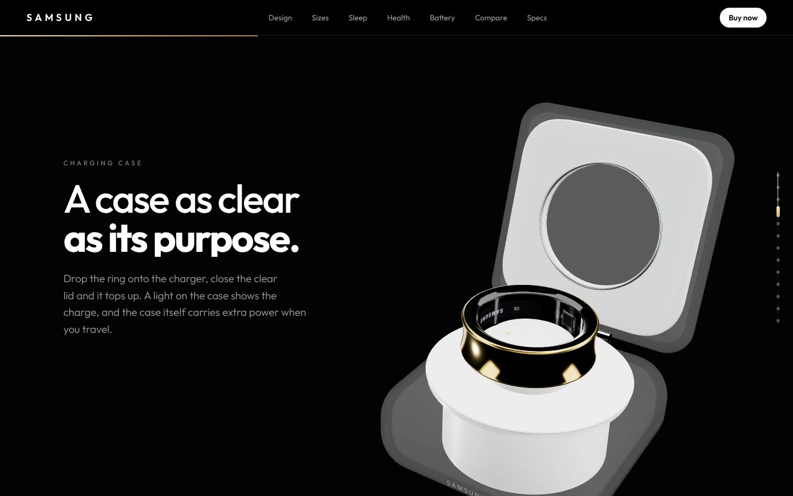 | 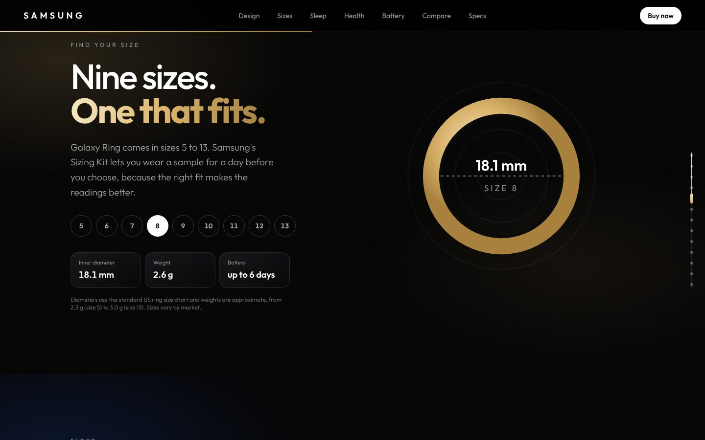 |
| **Charging case** | **Find your size** |
| 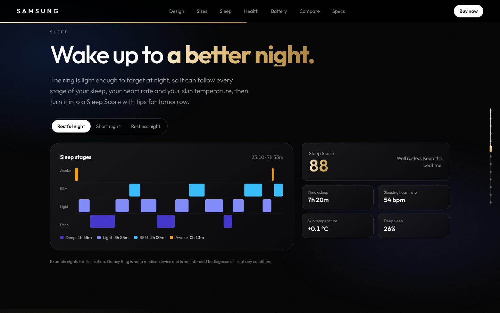 | 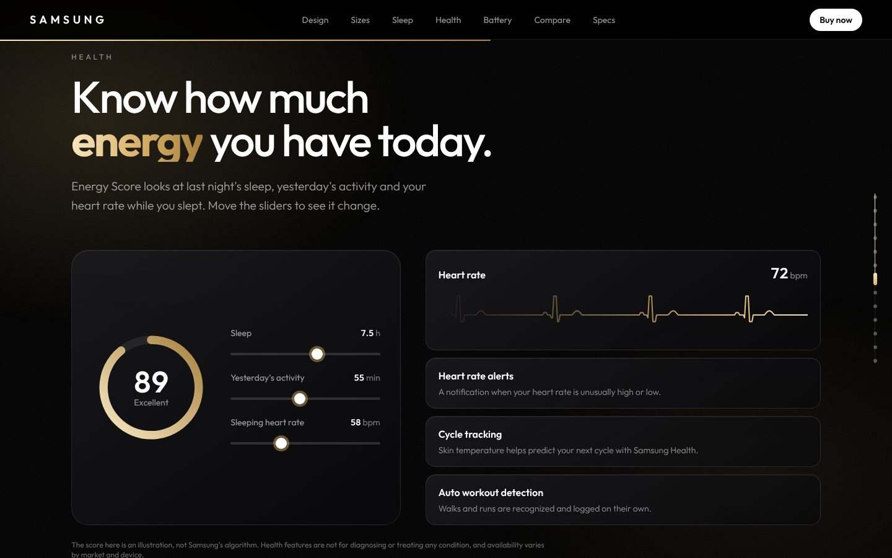 |
| **Sleep** stages and score | **Energy Score** |
| 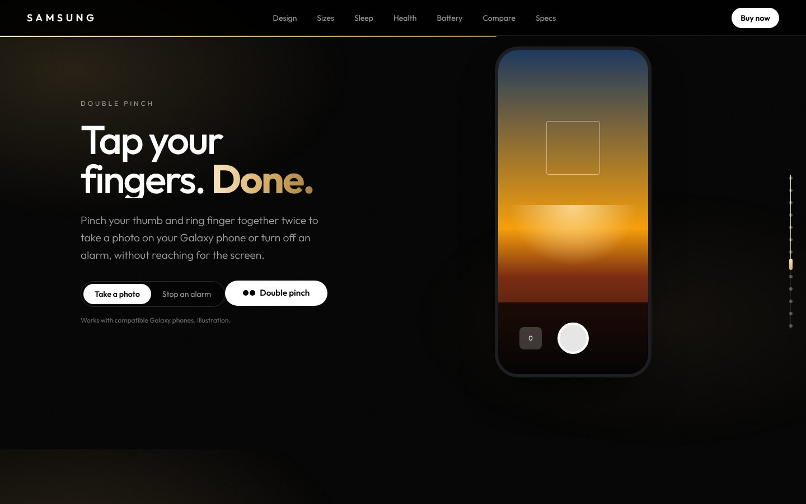 | 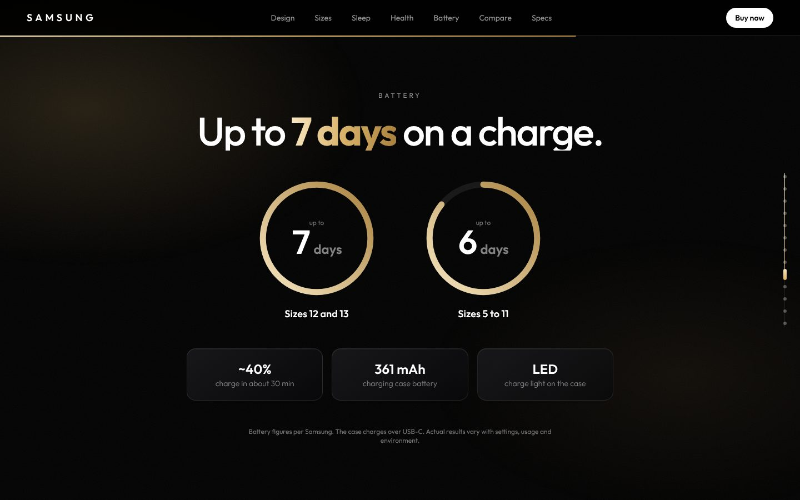 |
| **Double pinch** | **Up to 7 days** |
| 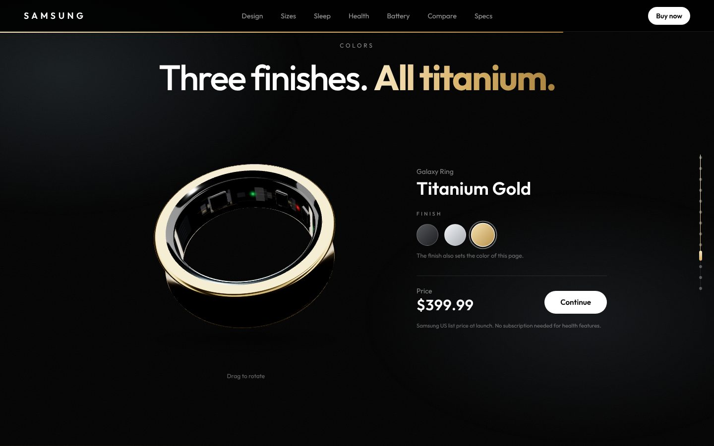 | 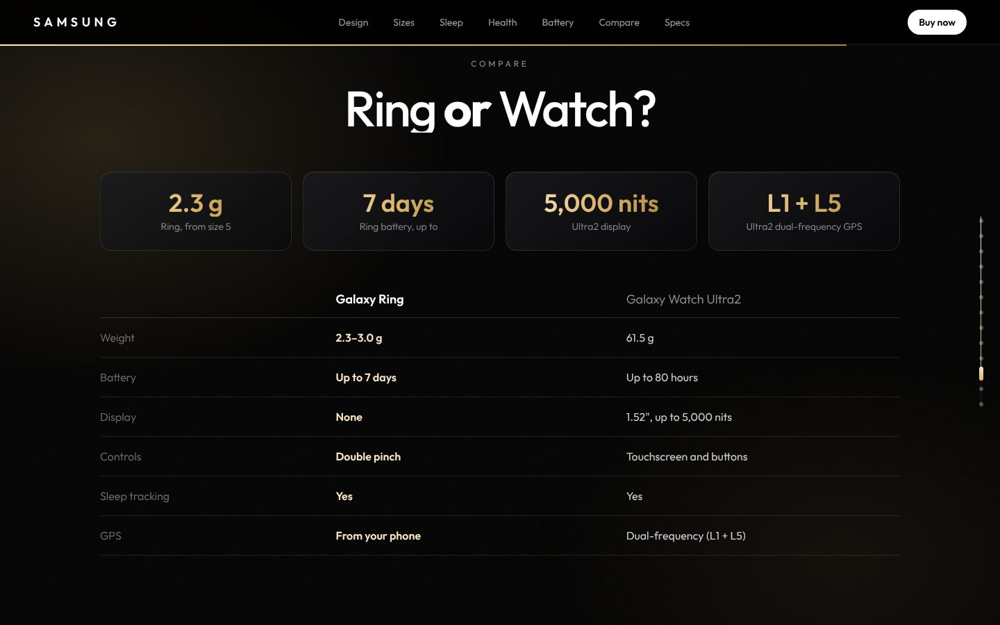 |
| **Three finishes** | **Ring or Watch?** |

### Mobile

| | | | |
|---|---|---|---|
| 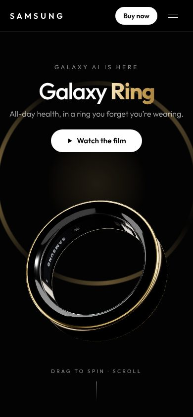 | 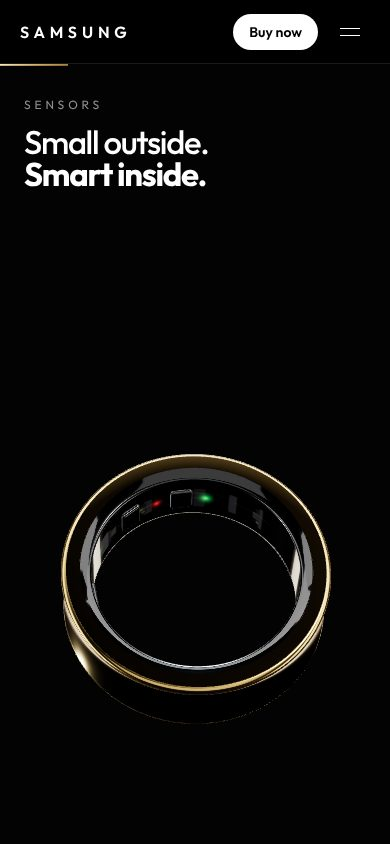 | 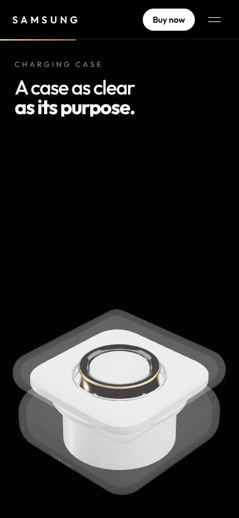 | 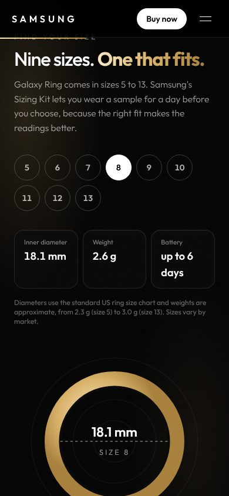 |

## Tech

- Next.js 16 (App Router, Turbopack), React 19, TypeScript, Tailwind CSS v4
- @react-three/fiber, @react-three/drei, three.js
- GSAP ScrollTrigger and Lenis for scroll

## Run locally

```bash
npm install
npm run dev
```

Open http://localhost:3000.

## Credits

Designed and built by Hasan Alp Güngör. Product names and specifications belong to Samsung; figures are from Samsung's public announcement and product pages.
